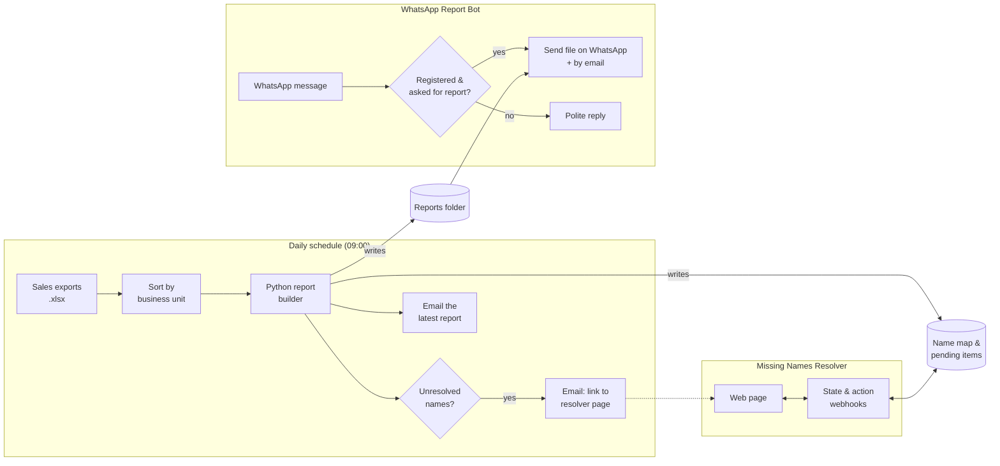

# Meraki Sales Reporting & WhatsApp Automation

A set of [n8n](https://n8n.io) workflows I built to automate daily sales reporting for a data analytics team. Every morning a report is built from the day's sales exports and emailed out. Staff can also ask for it on WhatsApp, and a small web page lets someone fix data problems (unknown customer names, missing account managers) before the next run.

It replaced a manual routine of collecting spreadsheets, cleaning customer names, building the cumulative report and sending it to people one by one.

## What's in here

| Workflow | What it does | Status |
|---|---|---|
| [Cumulative Sales Report](workflows/cumulative-sales-report.json) | Runs daily at 09:00. Sorts the day's Excel exports by business unit, runs a Python report builder, checks for unresolved data, and emails the finished report. | Live |
| [WhatsApp Report Bot](workflows/whatsapp-report-bot.json) | Listens for WhatsApp messages. When a registered number asks for the "cumulative report", it sends the latest file on WhatsApp and by email. Unregistered numbers get a polite refusal. | Live |
| [Missing Names Resolver](workflows/missing-names-resolver.json) | A self-contained web app served from n8n webhooks. Lists unmatched customer names with fuzzy-match suggestions and customers with no account manager, and lets a person map, add, assign or skip each one. | Live |
| [Management Tracker Chatbot](workflows/management-tracker-chatbot.json) | An AI agent ("Tracker Buddy") that lets managers update a department tracker in plain language, with an optional voice-note path through Whisper transcription. | In progress |

## How it fits together

## Highlights

- **Fault isolation.** Report delivery runs WhatsApp and email in parallel. A broken email expression used to stop the whole run, so the WhatsApp file never arrived either. I fixed the expression and set the email step to continue on error, so one channel failing no longer takes the other down. Write-up in [docs/overview.md](docs/overview.md#3-bug-found-unreliable-report-delivery).
- **Human in the loop, not a dead end.** Instead of silently dropping customers it can't match, the pipeline counts them, emails a link, and serves a resolver page with fuzzy-match suggestions. Decisions are saved, so the next run is cleaner.
- **Self-hosted WhatsApp.** Uses [WAHA](https://waha.devlike.pro) (WhatsApp HTTP API) running locally, including resolving WhatsApp's internal `@lid` sender IDs back to phone numbers.
- **Designed for non-technical users.** The tracker chatbot's prompt is written for busy, less tech-savvy managers: short sentences, confirm before saving, gentle reminders.
- **Room to grow.** Placeholder nodes mark where QuickBooks Desktop and Syspro data feeds will plug in once an integration method is chosen.

## Tech stack

n8n (self-hosted) · JavaScript (Code nodes) · Python (report builder & resolver API) · WAHA / WhatsApp · SMTP email · ClickUp · Microsoft Excel · LangChain AI Agent · Groq Whisper (planned)

## Running it yourself

1. Install n8n and import each file from `workflows/` (**Workflows → Import from file**).
2. Reconnect credentials. Each node that needs one shows `REPLACE_WITH_YOUR_CREDENTIAL`: SMTP for email, ClickUp, and Microsoft Excel for the tracker.
3. Replace the placeholders. Copy [`.env.example`](.env.example) to see the list: email addresses, `YOUR_WAHA_API_KEY`, and the `C:\automation\...` folder paths.
4. Run a WAHA instance on `localhost:3000` and point its webhook at `http://<n8n-host>:5678/webhook/whatsapp-incoming`.
5. The Python scripts the workflows call (`run_cumulative.py`, `resolve_api.py`) and the contacts file aren't included because they hold company data. The workflows show the inputs and outputs each script expects.

## Notes

- All company data, emails, keys, phone numbers and personal paths have been removed or replaced with placeholders.
- More detail: [docs/overview.md](docs/overview.md) (architecture, status, bug write-up) and [docs/how-it-works.md](docs/how-it-works.md) (step by step for each workflow).

## License

[MIT](LICENSE)
